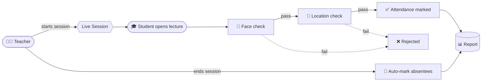
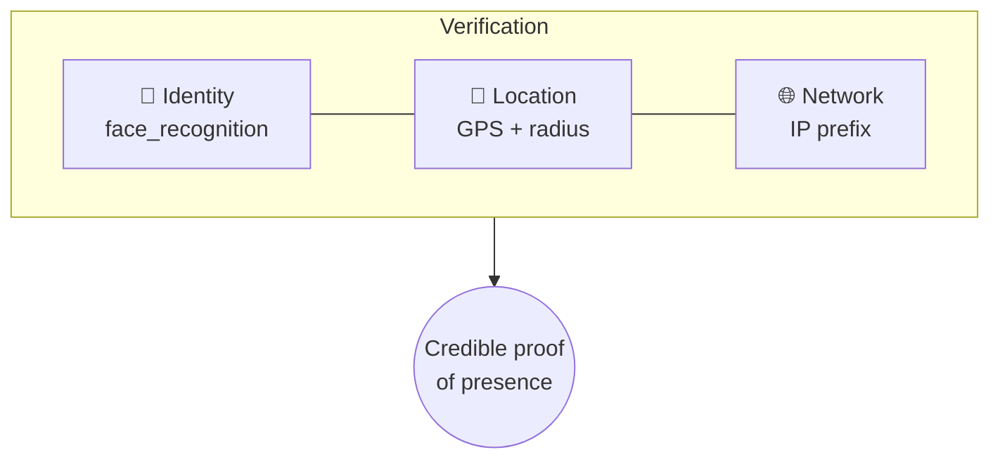
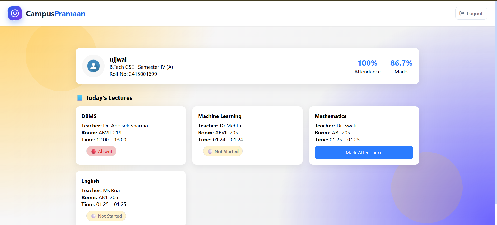
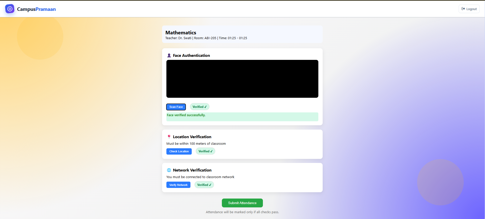
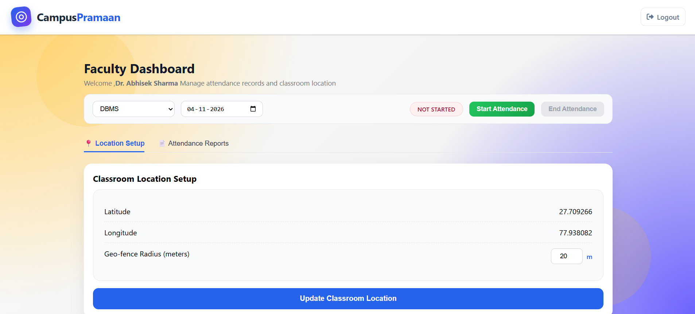

<div align="center">


<br/>


**Attendance isn't about marking someone present. It's about proving presence.**

[Features](#-features) • [How it works](#-how-it-works) • [Screenshots](#-screenshots) • [Quick start](#-quick-start) • [Roadmap](#-roadmap)

</div>

---

## 💡 What is CampusPramaan?

A **Django-based attendance system** that makes proxy attendance hard. Students must pass **identity + location checks** before they can mark themselves present in a live class session.

| 👩‍🏫 Teacher | 🎓 Student |
|---|---|
| Start / end attendance for a lecture | See scheduled lectures |
| Auto-mark absentees at session end | Verify face + location |
| View attendance report by lecture & date | Mark attendance once per lecture |

---

## ✨ Features

<table>
<tr>
<td align="center" width="25%">🧑‍💻<br/><b>Face Verification</b><br/><sub>Register once, match live capture</sub></td>
<td align="center" width="25%">📍<br/><b>Geofencing</b><br/><sub>GPS must be inside classroom radius</sub></td>
<td align="center" width="25%">🌐<br/><b>Network Check</b><br/><sub>IP prefix comparison utility</sub></td>
<td align="center" width="25%">⏱️<br/><b>Live Sessions</b><br/><sub>Teacher-controlled windows</sub></td>
</tr>
<tr>
<td align="center">🚫<br/><b>No Duplicates</b><br/><sub>One record per student / lecture / date</sub></td>
<td align="center">🤖<br/><b>Auto Absent</b><br/><sub>Unmarked students recorded on session end</sub></td>
<td align="center">📊<br/><b>Reports</b><br/><sub>Status + marking time per student</sub></td>
<td align="center">🔐<br/><b>Role-based Access</b><br/><sub>Separate student & teacher flows</sub></td>
</tr>
</table>

---

## 🔄 How It Works



### Three layers of trust



> ⚠️ **Current status:** Face and location are enforced at final submission. The network check exists as a module but is **not yet enforced** in the submit step. See the [Roadmap](#-roadmap).

---

## 🖼️ Screenshots

> Replace these placeholders with real screenshots. Save images in `assets/screenshots/`.

| Login | Student Dashboard |
|:---:|:---:|
|  |  |

| Face Verification | Teacher Dashboard |
|:---:|:---:|
|  |  |

---

## 🧱 Tech Stack

| Layer | Tools |
|---|---|
| Backend | Python, Django, Django REST Framework |
| Face | `face_recognition`, `dlib`, NumPy, OpenCV |
| Location | Browser Geolocation API, GeoPy, GeographicLib |
| Frontend | Django templates, HTML, CSS, JavaScript |
| Database | SQLite (default) |

## 📁 Project Structure

```text
CampusPramaan/
├── accounts/        👤 profiles, login, dashboards
├── attendance/      📅 lectures, sessions, records, reports
├── face_auth/       🧑 face registration & verification
├── location_auth/   📍 classroom coordinates & geofence
├── network_auth/    🌐 IP / network-prefix verification
├── config/          ⚙️ settings & root URLs
├── templates/       🎨 shared templates
└── static/          🖼️ static assets
```

---

## 🚀 Quick Start

**Requirements:** Python 3.12+, pip, Git (`dlib` may need a C/C++ build toolchain)

```bash
# 1. Clone
git clone "https://github.com/Ujjwal21kaushik/CampusPramaan"
cd CampusPramaan

# 2. Virtual environment
python -m venv .venv
source .venv/bin/activate          # Windows: .\.venv\Scripts\Activate.ps1

# 3. Install
pip install --upgrade pip
pip install -r requirements.txt

# 4. Set up database & admin
python manage.py migrate
python manage.py createsuperuser

# 5. Run
python manage.py runserver
```

On Windows, if an existing virtual environment reports `No Python at ...`,
remove it and recreate it with an installed Python version:

```powershell
Remove-Item -Recurse -Force .venv
py -3.13 -m venv .venv
.\.venv\Scripts\Activate.ps1
```

The face-recognition dependencies also require CMake and the Visual Studio
Build Tools C++ workload on Windows.

| App | Admin |
|---|---|
| http://127.0.0.1:8000/ | http://127.0.0.1:8000/admin/ |

Use the admin panel to create users, groups, student/teacher profiles, lectures and classroom location.

---

## 🔒 Before You Deploy

This is an **academic prototype**, not production-ready.

- [ ] Move `SECRET_KEY` to an environment variable
- [ ] Set `DEBUG = False` and restrict `ALLOWED_HOSTS`
- [ ] Configure `CSRF_TRUSTED_ORIGINS` and use **HTTPS** (needed for camera & GPS)
- [ ] Bind verification state to user + lecture + session, with short expiry
- [ ] Review permissions on every teacher/student endpoint
- [ ] Protect face data: consent, retention policy, access control (it is **biometric data**)
- [ ] Treat GPS and IP as *signals*, not tamper-proof proof

---

## 🗺️ Roadmap

- [x] Face registration & verification
- [x] Location geofencing
- [x] Live sessions + auto-absent
- [x] Attendance reports
- [ ] Enforce all 3 factors in one server-side validation service
- [ ] Liveness detection & anti-spoofing
- [ ] Verification expiry & replay protection
- [ ] Audit logs
- [ ] Analytics dashboard, CSV/PDF export
- [ ] Automated tests (permissions, duplicates, session lifecycle)
- [ ] Deployment config

---

## 🤝 Contributing

1. Fork the repo
2. `git switch -c feature/your-feature`
3. Commit and push
4. Open a Pull Request

## 📄 License

No license yet. Add a `LICENSE` file before sharing or reusing this project.

---

<div align="center">

**CampusPramaan — प्रमाणित उपस्थिति। सुरक्षित परिसर।**

*Where campus presence meets digital trust.* · Built with Django & Python

</div>
