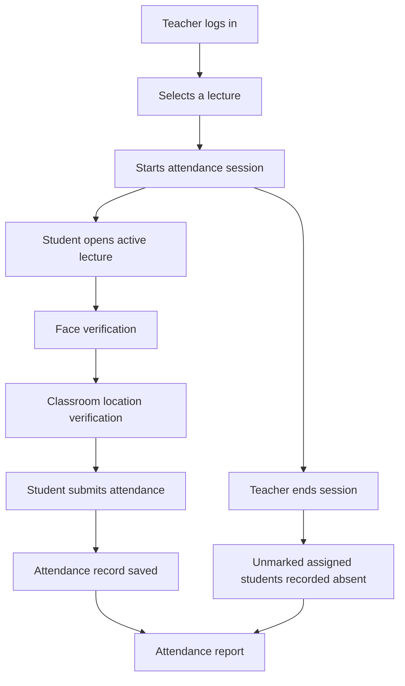

<div align="center">

# VeriAttend
### Intelligent, Multi-Layer Campus Attendance System

**A Django-powered attendance platform designed to make classroom attendance more reliable through identity and classroom-presence verification.**


</div>

---

## Overview

**CampusPramaan** is a role-based campus attendance management system built with Django. It provides separate workflows for teachers and students and combines face verification, classroom geolocation checks, and network-based verification utilities to help reduce proxy attendance.

Teachers can manage lecture attendance sessions, while students can view their scheduled classes and mark attendance when an active session is available. At the end of a session, the system can automatically record absent status for students assigned to that lecture who have not marked themselves present.

> **Core idea:** Attendance should represent both the right student and the right classroom context—not just a button click.

## Why VeriAttend?

Traditional attendance workflows can be time-consuming and vulnerable to proxy attendance. VeriAttend explores a layered approach:

- **Identity check:** Face registration and face matching using `face_recognition`.
- **Location check:** Compare a student's browser-provided coordinates with the configured classroom location and allowed radius.
- **Network check:** A network-authentication module compares IP network prefixes for a lecture session.
- **Session control:** Teachers start and end attendance windows for individual lectures.
- **Accountability:** Attendance records are associated with students, lectures, dates, and statuses.

## Key Capabilities

| Capability | Description |
|---|---|
| Role-based access | Separate student and teacher login/dashboard flows |
| Face registration | Save a student's face encoding for later verification |
| Face verification | Compare a live capture with the registered face encoding |
| Classroom geofencing | Check whether the reported coordinates fall within the configured classroom radius |
| Network verification | Create a session network prefix and compare it with a student's network prefix |
| Live attendance sessions | Teachers can start and end attendance for a lecture |
| Duplicate prevention | Restrict duplicate attendance records for the same student, lecture, and date |
| Automatic absence marking | Mark assigned students absent when the teacher ends the session, if no present record exists |
| Attendance reports | Return student-wise attendance status and marking time for a selected lecture/date |

## How It Works



### Attendance verification flow

1. A teacher starts an attendance session for a lecture.
2. The student opens the active lecture's attendance page.
3. The student completes face verification using their registered face encoding.
4. The application checks the student's reported location against the configured classroom coordinates and radius.
5. Once the required checks are satisfied, the student submits attendance.
6. When the teacher ends the session, the system identifies assigned students without a present record and creates absent records.
7. Teachers can request a report for a lecture and date.

**Implementation note:** The repository contains a network-prefix verification module as an additional verification utility. In the current attendance submission view, the final submission checks face and location session flags; network verification is not yet enforced as a required condition in that final submission path. Review and integrate that check before describing the application as enforcing all three factors.

## Tech Stack

- **Backend:** Python, Django
- **API responses:** Django `JsonResponse`, Django REST Framework dependency
- **Authentication:** Django authentication and groups
- **Database:** SQLite (default configuration)
- **Face processing:** `face_recognition`, `dlib`, NumPy, OpenCV
- **Geolocation:** Browser Geolocation API, GeoPy / GeographicLib utilities
- **Frontend:** Django templates, HTML, CSS, JavaScript

## Project Structure

```text
attendance_system/
├── accounts/          # Student/teacher profiles, login and dashboards
├── attendance/        # Lectures, sessions, attendance records and reports
├── face_auth/         # Face registration, encoding and verification
├── location_auth/     # Classroom coordinates and geofence verification
├── network_auth/      # Client IP and network-prefix verification
├── config/            # Django project settings and root URLs
├── templates/         # Shared and authentication templates
├── static/            # Static assets
├── manage.py
└── requirements.txt
```

## Getting Started

### 1. Prerequisites

- Python **3.12 or later**
- pip
- Git
- A working C/C++ build environment may be required by `dlib`, depending on your operating system and Python environment.

### 2. Clone the repository

```bash
git clone <YOUR_GITHUB_REPOSITORY_URL>
cd attendance_system
```

### 3. Create and activate a virtual environment

**Windows PowerShell**

```powershell
python -m venv .venv
.\.venv\Scripts\Activate.ps1
```

**macOS / Linux**

```bash
python3 -m venv .venv
source .venv/bin/activate
```

### 4. Install dependencies

```bash
python -m pip install --upgrade pip
pip install -r requirements.txt
```

> **Dependency tip:** `dlib` and `face_recognition` can require additional system-level build dependencies. If installation fails, install the prerequisites for `dlib` on your operating system and retry.

### 5. Apply database migrations

```bash
python manage.py migrate
```

### 6. Create an admin account

```bash
python manage.py createsuperuser
```

### 7. Start the development server

```bash
python manage.py runserver
```

Open:

- Application: `http://127.0.0.1:8000/`
- Django admin: `http://127.0.0.1:8000/admin/`

Use the Django admin to manage users, groups, student/teacher profiles, lectures, and classroom configuration as applicable to your setup.

## Important Configuration & Security Notes

This repository is an **academic / development prototype**, not a production-ready attendance service. Before deploying it publicly:

- Move `SECRET_KEY` into an environment variable and replace the committed development key.
- Set `DEBUG = False`.
- Replace `ALLOWED_HOSTS = ["*"]` with your actual hostnames.
- Configure `CSRF_TRUSTED_ORIGINS` for your deployment domain.
- Use HTTPS. Browser geolocation and camera access generally require a secure context (localhost is normally treated as secure for development).
- Review authorization on every teacher-only and student-only endpoint.
- Bind verification state to the specific user, lecture, and attendance session, and expire it after a short period.
- Integrate network verification into the final attendance submission path if it is intended to be a mandatory factor.
- Treat browser-provided GPS coordinates and IP-derived network checks as signals, not tamper-proof proof of physical presence.
- Add consent, retention, and access controls for biometric data. Face encodings are sensitive personal data.
- Configure a production database, static/media storage, logging, backups, and monitoring.

## Current Scope & Future Improvements

Potential next steps for taking VeriAttend further:

- Enforce all verification factors in one server-side attendance validation service.
- Bind face, location, and network verification to a unique attendance session.
- Add verification expiry, replay protection, and stronger anti-spoofing/liveness checks.
- Add audit logs for attendance changes and verification attempts.
- Add analytics dashboards, CSV/PDF exports, and attendance trends.
- Add automated tests for role permissions, duplicate attendance, session lifecycle, and verification failures.
- Add deployment configuration and environment-based settings.

## Contributing

Contributions and suggestions are welcome.

1. Fork the repository.
2. Create a feature branch: `git switch -c feature/your-feature`.
3. Commit your changes with a clear message.
4. Push your branch and open a pull request.

## License

No license has been included yet. Add a `LICENSE` file before distributing or reusing this project under explicit open-source terms.

---

<div align="center">

**VeriAttend — Verify the presence. Trust the record.**

Built with Django and Python.

</div>
